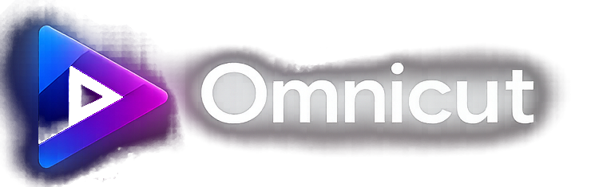

<p align="center">
  
</p>

# OmniCut

**A deterministic video editor that an AI agent can drive end-to-end — without ever generating a single pixel.**

OmniCut composes real footage using real, auditable engines (FFmpeg, a real timeline model, real
audio analysis) and lets an AI agent operate those engines the same way you would: cutting,
trimming, adding text, mixing audio, scheduling a release calendar. Every output — a rendered
clip, a music video, a YouTube upload — is something you could inspect, reproduce, and hand-edit
yourself. Nothing is hallucinated.

## Philosophy

OmniCut is built on a specific belief about how AI should be used in creative and operational
tools: **deterministic systems come first.**

Every pixel in a rendered video is produced by FFmpeg — a real, inspectable, repeatable render
engine — never generated or guessed by a model. Every scheduled YouTube upload happens through
the real YouTube API, with a plain JSON file recording exactly what was decided and when. AI's
job is to fill the gaps that deterministic automation genuinely can't reach on its own: reading a
vague instruction like *"make the drop hit harder,"* deciding which clip goes where, writing a
title, picking a color palette, following a multi-step creative request through to the end. The
moment a task can be done reliably *without* AI, it should be — not because AI can't do it, but
because a deterministic system is more inspectable, more repeatable, and keeps a person in
authority over a legible process instead of a single opaque generation.

That's what **"human in the middle"** means here, even when an entire pipeline runs unattended
end-to-end. At every layer, the actual decisions are legible artifacts — a timeline JSON, an
exact FFmpeg command, a queue file with every scheduled date in it — not a black box. An agent
can drive the whole thing, but it's driving the *same* tools you could pick up and drive
yourself, producing the *same* kind of output you can inspect, resume, or override at any point.
That is the difference between "AI video" and what OmniCut does instead.

## Who this is for

- **Musicians and producers** who need a real visualizer/music-video for every release, without
  hiring an editor or hand-animating each track — reactive, audio-synced videos generated
  directly from a cover + a song.
- **Independent artists and creators running multiple channels or brands** (a music project,
  a second channel for a different audience, whatever comes next) who want one release pipeline
  instead of juggling logins and manually uploading on a schedule.
- **YouTube creators** who want a real release calendar — schedule now, publish later, sync
  playlists automatically — instead of clicking "upload" one video at a time.
- **Anyone who wants AI *assistance* in editing without "AI video."** If you want a model to make
  editing decisions but refuse to accept generated/hallucinated footage, this is that tool.
- **Developers** who want a programmable, MCP-exposed video/publishing engine they can script,
  extend, or drive from their own agents.

## Capabilities

- **Timeline editor** — a real Electron/React GUI: media bin, drag-to-arrange timeline, live
  composited preview, export. The AI and the GUI edit the *same* project file, live.
- **AI Editor console, built in** — connect any agent CLI on your PATH (Claude Code today) right
  inside the app; watch it make edits as you would, tool call by tool call.
- **MCP server** — 29 deterministic editing tools exposed to any external MCP client.
- **Reactive music-video engine** — turns a cover (static or animated) + a song into a full-length
  video with a real per-song audio-reactive EQ, screen-shake on real kicks, falling dust, Ken
  Burns motion — all driven by an actual FFT of *that* track, not a canned animation.
- **YouTube publish system** — a scheduled upload queue, automatic playlist sync, multi-account
  support, and real OS-level scheduled automation — with full GUI parity, not just a CLI.
- **Packaged, installable app** — a real Windows installer, not just "run from source."

---

## Architecture

```
┌────────────────────────────────────────────────────────────────────┐
│                    timeline.json  (single source of truth)          │
│         media · tracks · clips · effects · text · transitions        │
└───────────────▲───────────────────────────────────────▲────────────┘
                │ mutates                                 │ reads
        ┌───────┴────────┐                        ┌───────┴────────┐
        │  MCP server     │                        │  Electron GUI   │
        │  (29 AI tools)  │                        │  preview + edit │
        └───────┬────────┘                        └────────────────┘
                │ render
        ┌───────▼────────┐
        │  FFmpeg engine  │  → deterministic MP4 (H.264/AAC)
        └────────────────┘
```

The AI (via MCP, or the in-app agent console) and you (via the GUI) edit the **same project
files**, so edits the agent makes appear live in the app, and vice-versa. The same principle
carries into the publish system: the CLI and the GUI's Publish panel call the exact same backend
functions, so nothing behaves differently depending on which one you used.

## Packages

| Package | What it is |
|---|---|
| `packages/core` | Platform-agnostic timeline model + edit operations. Pure TypeScript, **no native deps** — this is what ports to mobile later. |
| `packages/engine-ffmpeg` | Probes media, compiles a timeline into a single deterministic FFmpeg invocation, and drives the reactive music-video engine (real FFT, per-frame RGBA generation streamed into FFmpeg). FFmpeg ships bundled via `ffmpeg-static`. |
| `packages/youtube` | The publish system: OAuth (multi-account), upload queue, playlist sync, scheduling. One implementation shared by the CLI and the GUI. |
| `packages/mcp-server` | Model Context Protocol server exposing 29 editing tools to any MCP client (Claude Desktop, Claude Code, …). |
| `apps/desktop` | Electron + React desktop app: media bin, timeline, live preview, export, AI Editor console, Publish panel. |

---

## Setup (running from source)

```bash
npm install
npm run build
```

`npm install` downloads the bundled FFmpeg, Electron, and (if you use YouTube publishing)
electron-builder binaries. If your npm blocks install scripts, approve them once:
`npm install-scripts approve ffmpeg-static esbuild electron electron-winstaller`.

## Building a release (packaged installer)

To produce a real, standalone Windows installer instead of running from source:

```bash
cd apps/desktop
npm run package:installer
```

This builds `apps/desktop/release/OmniCut Setup <version>.exe` — a real NSIS installer (~200MB,
bundles Electron + FFmpeg + everything needed) that installs and runs independently of this repo
or Node.js. For a quick unpacked build without an installer (faster, useful for testing), use
`npm run package` instead — it produces `apps/desktop/release/win-unpacked/OmniCut.exe` directly.

**macOS:** electron-builder can only produce a `.dmg`/`.app` when run *on* macOS (Apple's
packaging tools aren't cross-platform), so a Mac build can't be produced from Windows locally.
The same `npm run package:installer` command works unchanged on a Mac and produces a universal
(`x64` + `arm64`) `.dmg`. This repo's [GitHub Actions release workflow](.github/workflows/release.yml)
builds both the Windows installer and the macOS `.dmg` automatically in the cloud for every
tagged release, so you don't need to own a Mac to ship one — see the Releases page for
ready-built downloads of both. Since Mac builds here aren't Apple-notarized, macOS will show an
"unidentified developer" warning on first launch — right-click the app → **Open** once to bypass it.

## Run the desktop app from source

```bash
npm run desktop
```

- **New** → pick a format (1080p / vertical / square).
- **Import media…** → add video/audio/images. Double-click an item to drop it on the timeline.
- Drag clips to move them; click to select and edit in the right-hand inspector.
- **▶** plays a live composite preview (video + text + PiP + audio).
- **Export MP4** renders the deterministic final via FFmpeg.

---

## Command the AI *inside* the app (recommended)

Click **🤖 AI Editor** in the toolbar. A glass console slides in on the right:

1. It **auto-detects** an agent CLI on your PATH (currently Claude Code; the list is
   extensible). Pick one and hit **Connect**.
2. The app launches the agent in headless streaming mode, **pre-wired to the
   video-editor MCP server** and pointed at your currently-open project — no config needed.
3. Type an edit in plain language ("trim the intro to 5s, add a title, drop the music to
   30% with a 2s fade, then render"). You'll see each tool the agent runs as a chip
   (✂️ Trim, 🎞️ Transition, 🎥 Render), and the timeline/preview update live as it works.

Requirements: the agent CLI must be installed and signed in (run `claude` once in a normal
terminal to confirm you're authenticated). The app runs the agent with
`--permission-mode bypassPermissions` so tool calls don't prompt — it's your machine, your agent.

## Connect the AI externally (MCP)

The MCP server is `packages/mcp-server/dist/index.js`. Point any MCP client at it.

**Claude Code:**
```bash
claude mcp add video-editor -- node "<path-to-cloned-repo>/packages/mcp-server/dist/index.js"
```

**Claude Desktop** — add to `claude_desktop_config.json`:
```json
{
  "mcpServers": {
    "video-editor": {
      "command": "node",
      "args": ["<path-to-cloned-repo>/packages/mcp-server/dist/index.js"]
    }
  }
}
```

Both the GUI and the MCP server default to the project store at
`~/VideoEditor` (override with the `VIDEO_EDITOR_HOME` env var). Renders land in
`~/VideoEditor/renders`. Because they share this folder, **open the app and let the AI edit —
its changes appear live.**

### Example prompt to the agent

> Create a 1080p project called "Trip". Import `C:/clips/beach.mp4` and `C:/music/track.mp3`.
> Put the first 8 seconds of beach.mp4 on the main track, add a title "Summer 2026" for the
> first 3 seconds, put the music underneath at 30% volume with a 2s fade-out, then render it.

## The 29 MCP tools

- **Session:** `create_project`, `open_project`, `save_project`, `list_projects`, `get_timeline`, `undo`, `redo`
- **Media:** `import_media`
- **Tracks:** `add_track`, `set_track_muted`, `remove_track`
- **Clips:** `add_clip`, `trim_clip`, `split_clip`, `move_clip`, `delete_clip`, `ripple_delete`, `compact_track`
- **Effects:** `set_clip_speed`, `set_clip_volume`, `set_clip_opacity`, `set_clip_fades`, `set_clip_audio_fades`, `set_clip_transform`, `set_transition`
- **Text:** `add_text`, `update_text`
- **Render:** `render`, `create_music_video`

Every tool returns the full, id-annotated timeline so the agent stays grounded on the exact
state after each edit.

---

## Music videos ("Living Cover")

Turn a cover image + a song into a 1080p video the length of the track, with deterministic
motion and music-synced energy: sharp cover centered over a **blurred fill**, slow **Ken Burns**
zoom, an **audio-reactive visualizer** (waveform / bars / spectrum), and **film grain + vignette**.
All FFmpeg-native — no generative frames.

**One video (MCP tool `create_music_video`):** the agent calls it per song, e.g.
> "Make a music video from `cover.png` and `track.wav`."

**Reactive mode** (`reactive: true` on the tool, or `--reactive` on the batch): a high-energy
variant driven by the actual audio — the whole frame **shakes on the beats**, **zoom-pulses on the
bass**, a big **full-width EQ slams in sync with real kicks** (not just generic loudness),
**ambient dust falls from above** and thickens in the heavy sections, and can drive an **animated
background** (e.g. an AI-animated cover) instead of a static image — with automatic watermark
removal via a targeted blur patch.

The EQ is genuinely per-song: each of its 32 bands is analyzed via a real FFT and normalized
against *that track's own* dynamic range, then coupled to the same kick-detector driving the
screen-shake — so the whole EQ visibly swells together exactly when a real hit lands, and no two
songs produce the same pattern. Dust density is driven by the *same* signal too, normalized against
the track's own busiest stretch. Everything (bars, dust, shake, zoom) is generated
deterministically in JS and streamed straight into FFmpeg — same song + cover always renders
identically. Frame 0 is always left clean (no overlay) — a ready-made YouTube thumbnail.

**Batch (loop over a folder):** pairs each audio file with its cover by name and renders all:
```bash
node scripts/make-music-videos.mjs "<coversDir>" "<songsDir>" "<outDir>" --reactive
```
Add `--dry` to preview the song→cover pairing, `--reactive` for the high-energy mode, or
`--style bars|spectrum|waveform` to pick the calm-mode visualizer. Re-running skips finished videos,
so an interrupted batch resumes. Covers match songs by name (`Track.wav` ↔ `Track cover.png`).

For an album sharing one animated background/cover across every track (rather than unique art per
song), see `scripts/make-album-videos.mjs` — it adds a per-song title bar and a rotating accent
color so each video stays visually distinct.

---

## YouTube publish system

A full release pipeline: a scheduled upload queue, automatic playlist sync, multi-account
support, and real scheduled automation — usable identically from the CLI or from the **📤
Publish** panel in the desktop app. The CLI and the GUI call the exact same backend
(`packages/youtube`), so nothing behaves differently between them.

### What it does

- **Scheduled queue** — upload every video **private** now, with a **publishAt** you set; YouTube
  auto-flips each one to public at that exact moment. Nothing goes live without a schedule you
  chose.
- **Quota-aware, resumable** — YouTube's API defaults to a 10,000-unit daily quota (uploads cost
  1,600 units each, so ~6/day) — the queue uploads what it can and picks up where it left off next
  run, automatically.
- **Playlist sync** — configure a playlist per folder; syncing only adds videos **confirmed
  actually live** (checked against YouTube's real current status, not a possibly-stale local
  record) — private/scheduled videos are never added early, even though a private video inside a
  public playlist would technically stay hidden anyway.
- **Multi-account** — one Google Cloud OAuth app can authorize many different YouTube channels;
  each folder picks which account it uploads to, so a primary channel and any number of other
  channels coexist cleanly under one dashboard.
- **Real concurrency** — uploads for *different* accounts run genuinely in parallel; uploads for
  the *same* account safely queue and wait their turn (never race the same credentials) — whether
  triggered from the CLI, the GUI, or a scheduled task, all at once.
- **Real scheduled automation** — enable a daily auto-run per folder and OmniCut registers an
  actual Windows Task Scheduler entry (not a JS timer) that uploads + syncs even when the app is
  closed.
- **Auto thumbnails** — each video's thumbnail is pulled straight from its own clean frame 0 (see
  above) — no separate thumbnail step.

### One-time setup (~10 minutes, you do this part — it needs your own Google login)

1. Go to [console.cloud.google.com](https://console.cloud.google.com), create (or pick) a project.
2. **APIs & Services → Library** → search "YouTube Data API v3" → **Enable**.
3. **APIs & Services → OAuth consent screen** → User type **External** → fill in the required
   fields (app name, your email) → under **Test users**, add your own Google account email.
   Leave the app in **Testing** status — no Google review needed for personal use. (Refresh
   tokens for apps in Testing expire after 7 days — you'll just re-authorize occasionally, one
   command + one browser click.)
4. **APIs & Services → Credentials → Create Credentials → OAuth client ID** → Application type
   **Desktop app** → **Create** → **Download JSON**.
5. Tell the tool where that file is:
   ```bash
   node scripts/youtube-queue.mjs init --client-secret "C:/path/to/downloaded.json"
   ```
   This opens your default browser to Google's consent screen — **you** log in and click Allow.
   Credentials save locally at `~/.omnicut/youtube/` — never inside a synced/cloud folder.
6. For custom thumbnails, your channel needs to be **phone-verified**: [youtube.com/verify](https://www.youtube.com/verify).

### Using the queue (CLI)

```bash
# Add every .mp4 in a folder, staggering the public release every 3 days from a start date,
# with an optional title prefix (e.g. your artist/channel name)
node scripts/youtube-queue.mjs add "C:/Users/you/Videos/MyAlbum/Completed" --start "2026-08-01 17:00" --title-prefix "Your Name"

# Review, then upload for real — stops gracefully at the daily quota, resumes on re-run
node scripts/youtube-queue.mjs run "C:/Users/you/Videos/MyAlbum/Completed" --dry
node scripts/youtube-queue.mjs run "C:/Users/you/Videos/MyAlbum/Completed"

# Configure and sync a playlist
node scripts/youtube-queue.mjs playlist-set "C:/Users/you/Videos/MyAlbum/Completed" --title "My Album" --privacy public
node scripts/youtube-queue.mjs sync-playlist "C:/Users/you/Videos/MyAlbum/Completed"

# Run every registered folder at once — concurrently, safely
node scripts/youtube-queue.mjs run-everything

# Multiple channels
node scripts/youtube-queue.mjs account-add second-channel --label "My Other Channel"
node scripts/youtube-queue.mjs account-set "<folder>" --account second-channel
```

Run `node scripts/youtube-queue.mjs` with no arguments for the full command list (accounts,
folders, rescheduling, thumbnail retries, and more).

### Using the queue (GUI)

Click **📤 Publish** in the desktop app's toolbar for the same capabilities as buttons: connect
accounts, pick folders, edit each video's title/schedule inline, run uploads, configure and sync
playlists, and toggle daily automation — with live progress as it works.

---

## How the render works

The first video track is the **main sequence** (clips end-to-end, joined by hard cuts or
`xfade` transitions, gaps filled with background). Other video/overlay tracks composite on top
as positioned overlays (PiP, images, `drawtext` titles), timed to their absolute positions.
Audio from every non-muted clip is trimmed, speed-matched (`atempo`), faded, positioned
(`adelay`) and mixed (`amix`) over a silent bed. See `packages/engine-ffmpeg/src/compile.ts` for
the main timeline compiler, or `packages/engine-ffmpeg/src/reactive.ts` for the music-video engine.
